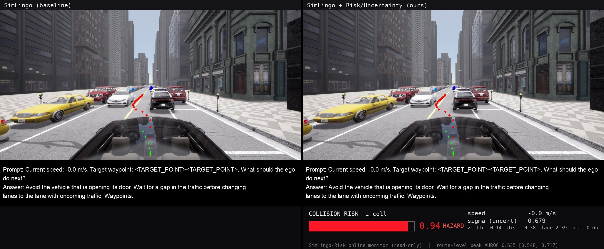
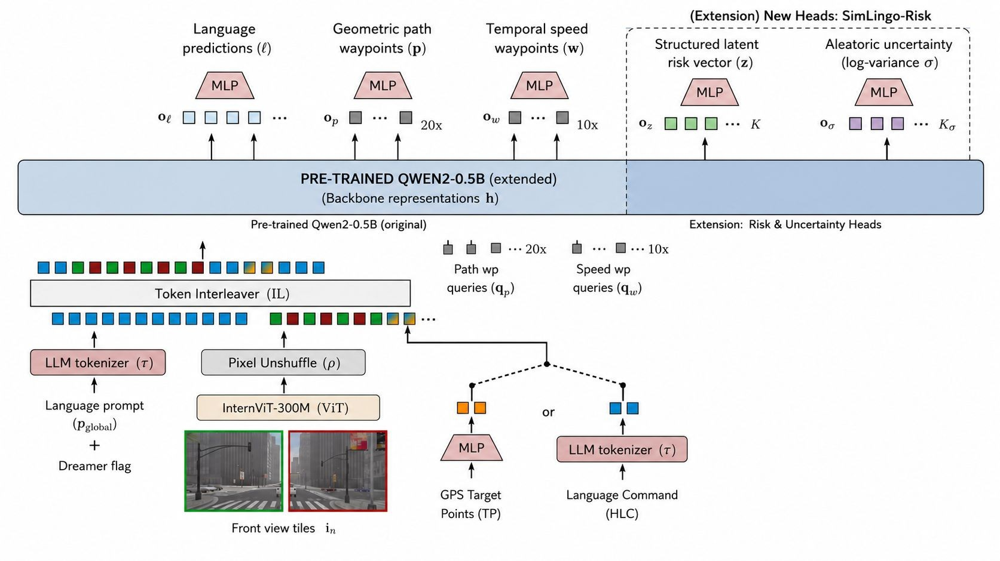

# SimLingo-Risk

**Building and Testing a Collision-Risk Monitor for a Vision–Language–Action Driving Model**

Layan Anabosi · Nawar Sgier — Advisor: Elad Amrani

Henry and Marilyn Taub Faculty of Computer Science, Technion – Israel Institute of Technology

[**Paper (PDF)**](paper/SimLingo-Risk.pdf) · [**Project page**](https://nawar21.github.io/SimLingoRisk-/) · [**Demo video**](assets/video/simlingo-risk-demo.mp4)

> **Code will be released publicly.**



## Summary

[SimLingo](https://arxiv.org/abs/2503.09594) drives from camera images and explains its actions in words, but it never reports how dangerous a scene is. We trained a small probe (264K parameters) on the last hidden state of the frozen model to predict a collision-hazard score and an action uncertainty, and ran it live in CARLA as a read-only monitor. It never changes how the car drives.



## Results

| Test | Collision-hazard AUROC |
|---|---|
| Pilot: 5 held-out routes, one scenario type (549 frames) | 0.595 |
| Held-out frames (offline, 117K-frame cache, 5 seeds) | 0.960 ± 0.001 |
| Unseen scenario type (leave-one-scenario-out) | 0.748 ± 0.071 |
| Live, which routes collide (216 Bench2Drive routes, mean score) | 0.659 [0.570, 0.743] |
| Live, when the collision happens (16 collision routes) | 0.504 |

The monitor flags dangerous routes, but not the moment of impact. Feeding the predicted risk back into action prediction did not reduce action error. Full details, limitations and appendix tables are in the [paper](paper/SimLingo-Risk.pdf).

## Repository

```
paper/SimLingo-Risk.pdf     final report
paper/src/                  LaTeX source and figures (build: tectonic main.tex)
assets/video/               demo video and short clips
index.html                  project page (GitHub Pages)
```

## Citation

```bibtex
@misc{anabosi2026simlingorisk,
  title  = {SimLingo-Risk: Building and Testing a Collision-Risk Monitor
            for a Vision--Language--Action Driving Model},
  author = {Anabosi, Layan and Sgier, Nawar},
  year   = {2026},
  note   = {Final project report, advisor Elad Amrani, Technion -- Israel Institute of Technology}
}
```

SimLingo is the work of Renz et al. (CVPR 2025); this project uses its released weights without modification.
